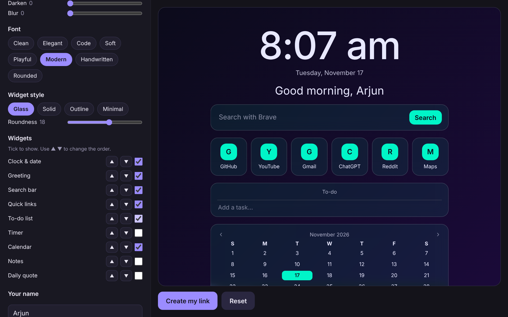
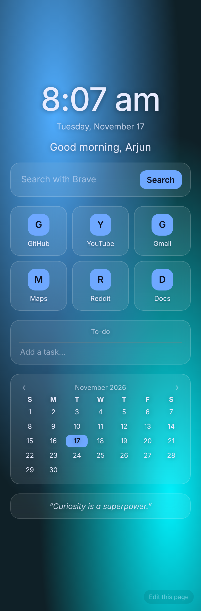
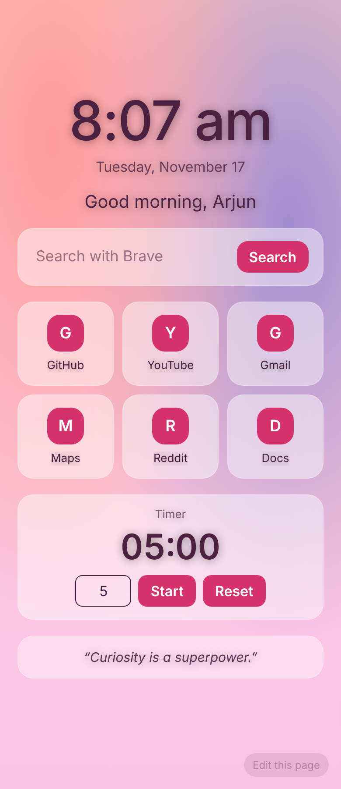

# homepagei

Design your own browser homepage, preview it live, and get a link to paste into your browser. No account, no server, no hosting steps. It uses standard web features and is tested in Chromium-based browsers (Chrome, Brave, Edge). It should also work in Firefox, Samsung Internet and other modern browsers on Android and desktop, but those are not tested yet.

**Live demo:** https://arjunvs-ace.github.io/Homepagie/

| Builder | Homepage (dark) | Homepage (light) |
|---|---|---|
|  |  |  |

## How it works

homepagei is one static page (`index.html`).

- **Builder:** open the site normally. Pick a theme, wallpaper, font, widget style, widgets and quick links while a live preview updates.
- **Homepage:** "Create my link" packs your choices into the link (`…/#c=…`). Opening that link shows your homepage.

Your settings live inside the link, so nothing is stored on a server. Your homepage shows a small “Edit this page” link that reopens the builder with your settings.

## Features

- 10 themes plus **Auto light/dark** (follows your device) and **Custom colors**
- 8 gradient wallpaper presets, an image link (with clear error messages), or your own upload, plus darken and blur
- 8 fonts, 4 widget styles, adjustable roundness
- Widgets: clock and date, greeting, search, quick links, to-do list, timer, calendar, notes, daily quote
- Reorder widgets with ▲ ▼ and show or hide any of them
- Optional site icons on links (loaded from DuckDuckGo’s icon service)
- Export and import your settings as a file, and a Share button for sending your link
- Choice of search engine (Brave, Google, DuckDuckGo, Bing)
- Mobile-friendly builder and homepage

## Put it online (free, about 2 minutes)

**With git:**

```
git init
git add .
git commit -m "Initial commit: homepagei homepage builder"
git branch -M main
git remote add origin https://github.com/<your-username>/<repo-name>.git
git push -u origin main
```

**Without git:** create a new repo on github.com, choose **Add file → Upload files**, drag in everything from this folder, and commit.

Then turn on the site: repo **Settings → Pages → Deploy from a branch → `main` / root → Save**. Your site appears at `https://<your-username>.github.io/<repo-name>/` after a minute.

## Use it as your homepage

1. Open your site, design your page, tap **Create my link**, then **Copy link**.
2. In your browser’s settings, find **Homepage** (Chrome, Brave, Edge, Samsung Internet and others have it). Turn it on and paste the link.
3. If your browser has no custom homepage option (for example Firefox on Android), bookmark the link or use **Add to Home screen**.

Browsers differ in whether the homepage also applies to new tabs. Often it only opens with the Home button.

## Wallpapers and copyright

Presets are generated gradients, so they are free to use. Uploaded wallpapers stay on your device and are never sent anywhere. For an image link, use pictures you have the right to use.

If an image link doesn’t load, the builder tells you why. The usual causes are a link to a web page instead of the image file, an `http://` link (only `https://` works), or a site that blocks other sites from using its pictures. Wallpapers fill the whole screen, so the edges of a photo may be trimmed.

## Security notes

- A Content Security Policy in `<head>` blocks scripts from other sites, injected inline scripts, `eval`, outside connections and form posts.
- The page refuses to run inside another site’s frame.
- Everything from the link is validated before use (theme, font and widget names are whitelisted; numbers are clamped), and all text is HTML-escaped. Only `http` and `https` links are allowed, so `javascript:` links are blocked.
- A homepage opened from someone else’s link shows a notice and the real domain under each shortcut. A wallpaper from another site isn’t loaded until you tap “Looks good”, so a crafted link can’t quietly reveal your IP address.
- Links open with no referrer (`noopener noreferrer`).
- Uploaded wallpapers stay in the browser (IndexedDB) and are never uploaded anywhere. Use an image link if you want the wallpaper on every device.
- Notes and the to-do list are saved unencrypted in the browser. Don’t keep passwords in them.
- Your link contains your settings (name, shortcuts), so don’t post it publicly.
- Fonts load from Google Fonts. To remove that, delete the font `<link>` tags and the two `fonts.g…` entries in the CSP.

## Editing the script

The CSP only allows the exact `<script>` block it was generated for. **If you change the script, update the hash in the CSP tag or the page will stay blank.** Print the new hash with:

```
node -e "const s=require('fs').readFileSync('index.html','utf8').match(/<script>([\\s\\S]*)<\\/script>/)[1];console.log('sha256-'+require('crypto').createHash('sha256').update(s).digest('base64'))"
```

## Similar projects

There are many good startpages out there. Most are projects you edit by hand. homepagei is a builder: you click options, see a live preview, and get a link with no files to edit.

| Project | How you customize it | Good for |
|---|---|---|
| **homepagei** (this repo) | Click options in a builder with live preview, upload a wallpaper, copy one link | People who want a custom homepage with no code |
| [StartTreeV2](https://github.com/AlexW00/StartTreeV2) | Generator site hosted on GitHub Pages, tree-style look, new themes added in code | A terminal-style homepage with no hosting |
| [MinTab](https://github.com/newmanls/MinTab) | Built-in settings window, themes, quotes, 12/24-hour clock | Quick start, just set its address as your homepage |
| [Modern Start Page](https://github.com/ericblue/modern-start-page) | Settings modal and config file, widgets, several search engines, Docker option | A feature-rich, self-hosted dashboard |
| [Startpage by Dadangdut33](https://github.com/Dadangdut33/Startpage) | Bookmarks in JSON, styles with CSS variables | Deep restyling with CSS |
| [start.page](https://github.com/realSPectr0/start.page) | Edit the project files, built-in themes, image widget | A lightweight local homepage |
| [Shelf](https://github.com/dan-smith-tech/shelf) | Edit plain HTML, bookmarks sized by importance | A simple, fast page for developers |
| [ttntm/startpage](https://github.com/ttntm/startpage) | Links and categories in JSON, built with Eleventy | Organized link categories |
| [Flat](https://github.com/xverz/Flat) | Edit files, six themes, random quotes, search shortcuts | A personal, themed page |

For a bigger list, see [awesome-startpage](https://github.com/jnmcfly/awesome-startpage).

This comparison is based on each project's README in November 2026. Check each repo for its current features.

## License

MIT. See `LICENSE`.

## Ideas for contributors

News widget (needs a small proxy), “fit whole image” wallpaper option, link folders, custom text widget, QR code for sharing, drag-and-drop layout, installable web app (PWA), more themes and widgets.
